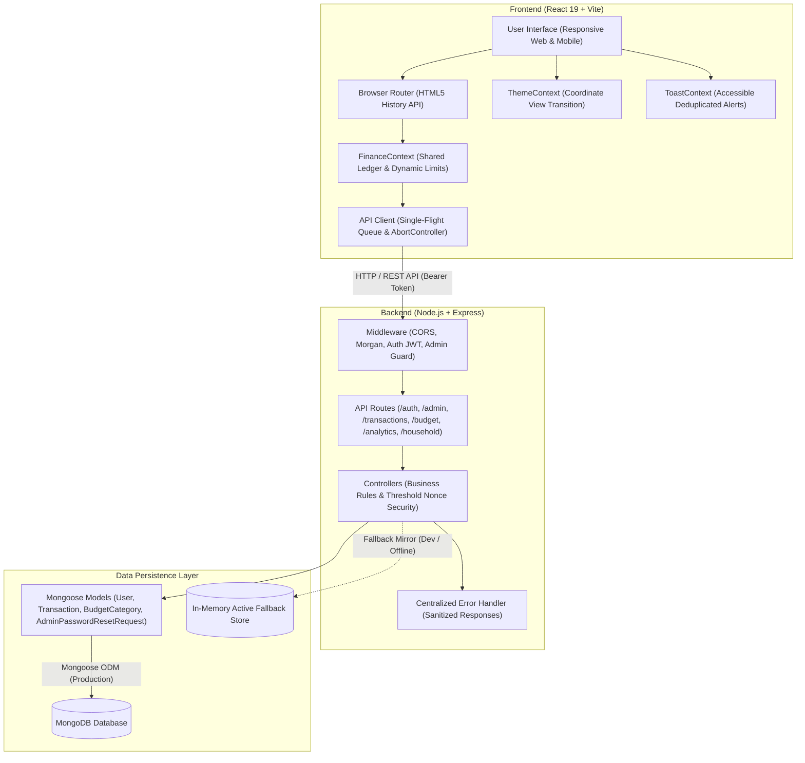

# SHAKA — Personal Finance & Shared Ledger


**SHAKA** is a full-stack, responsive personal finance and shared household expense ledger designed with an understated "quiet luxury" aesthetic (*Ledgerly* design system). It features a single shared financial ledger across all authenticated members, role-based administration, high-value transaction authorization gates, a dual-administrator password recovery workflow, optimistic UI updates with snapshot rollback, and coordinate-aware circular theme transitions.

---

## Table of Contents

- [1. Project Overview](#1-project-overview)
- [2. Key Features](#2-key-features)
- [3. Technology Stack](#3-technology-stack)
- [4. Project Architecture](#4-project-architecture)
- [5. Folder Structure](#5-folder-structure)
- [6. Installation and Setup](#6-installation-and-setup)
- [7. Environment Variables](#7-environment-variables)
- [8. API Documentation](#8-api-documentation)
- [9. Database Structure](#9-database-structure)
- [10. State Management](#10-state-management)
- [11. Authentication and Security](#11-authentication-and-security)
- [12. Deployment](#12-deployment)
- [13. Troubleshooting](#13-troubleshooting)
- [14. Future Improvements](#14-future-improvements)
- [15. License](#15-license)

---

## 1. Project Overview

SHAKA solves the problem of shared household, partner, and collaborative financial management without user-isolated silos. Unlike traditional expense trackers that partition accounts by individual users, SHAKA operates on a **single shared financial ledger**:

- **Unified Financial Ledger**: Every authenticated member contributes to and views the exact same transactions, categories, spending limits, and monthly summaries.
- **Privacy-Preserving Transactions**: Individual transaction cards and records display financial data without associating or displaying user creator labels.
- **Governed Budget Caps**: Total monthly spending ceilings are dynamically calculated as the combined sum of individual category limits.
- **Adaptive Responsive Experience**: Renders full-width desktop multi-column layouts on larger screens and touch-optimized card layouts with a floating bottom navigation bar and mobile bottom sheets on mobile devices.

---

## 2. Key Features

### Authentication & Session Management
- **JWT Authentication**: Short-lived access tokens (24 hours) with sliding refresh tokens (3 days) stored in secure cookies and local storage.
- **Single-Flight Refresh Queue**: Eliminates concurrency races when multiple asynchronous requests trigger token refresh simultaneously.
- **4-Digit Access Code Security**: Optional fast-auth verification layer with bcrypt hashing and automatic 15-minute account lockout after 5 consecutive failed attempts.
- **Role-Based Access Control (RBAC)**: Distinguishes between `Admin` and `Member` privileges (e.g., category creation, limit adjustments, and transaction deletion require administrator status).

### Shared Financial Management & Ledger
- **Single Shared Source of Truth**: Unified collection of all household income and expense items.
- **Dynamic Real-Time Budgeting**: Dynamic calculation of category health (`Healthy`, `Warning` at 80%+, `Exceeded` at 100%+), remaining monthly surplus, daily average spending, and projected month-end expenditure.
- **Threshold Expense Authorization**: Transactions exceeding **₹7,000** require secondary on-the-spot verification (Access Code or account password), generating a single-use cryptographically signed JWT authorization nonce with a 5-minute expiration.
- **Interactive Expense Logging**: Date picker with quick presets (`Today`, `Yesterday`, custom calendar modal), custom categories, amount validation, and split-expense toggles.

### Category & Limit Architecture
- **Dynamic Category Derivation**: Overall monthly budget limit automatically aggregates all individual category limits without redundant duplicate storage.
- **Custom Color Picker**: Preset luxury palette (Gold, Sage, Amber, Rose, Blue, Muted) with custom HTML5 color picker integration.
- **Inline Editing & Management**: Inline limit and category editing with modal confirmation for deletions.

### Dual-Admin Password Recovery System
- **Mutual Admin Approval**: An administrator who forgets their password cannot unilaterally reset it; a cryptographically signed reset request is sent to the other administrator.
- **In-App Approval Modal**: The approving admin reviews pending requests directly within their dashboard; once approved, a single-use reset token is authorized for the requester.

### UI/UX & Responsive Design System
- **Ledgerly Quiet Luxury Aesthetic**: Obsidian Dark (`#0e0e10`) and Alabaster Light (`#f6f5f2`) canvases, card surfaces (`#17171a`, `#ffffff`), and champagne gold accents (`#c9b27c`).
- **Coordinate-Based Circular Theme Transition**: Theme toggle measures the exact click coordinates $(x, y)$ and radiates an animated circular clip-path reveal using the native View Transitions API with CSS ripple fallback.
- **Optimistic UI Updates with Snapshot Rollback**: Immediate UI response for category and transaction mutations; automatically restores previous state snapshots with sanitized toast notifications if server validation fails.
- **Action Locking**: Prevents double-submission and request spamming on asynchronous buttons.

### Progressive Web App (PWA) & Offline Capabilities
- **Full Installability**: Native `beforeinstallprompt` support and custom in-app install modal with step-by-step guides for iOS Safari, Android, and Desktop (Chrome/Edge/Brave).
- **W3C Web App Manifest**: Complete metadata with `standalone` display mode, maskable and high-resolution icons (192px, 512px, Apple touch icon), and OS shortcuts for quick expense logging.
- **Service Worker Lifecycle**: Static asset pre-caching, app shell offline delivery, stale-while-revalidate for assets, and automatic cleanup of outdated cache versions.
- **Offline Fallback & Connectivity Status**: Custom branded offline page (`offline.html`) and real-time network reconnection banner with live network status indicator.
- **Sensitive Data Security**: Strictly excludes API mutating requests and private authorization tokens from persistent caches.
- **Instant In-App Updates**: Background update detection with a non-intrusive floating notification and instant reload activation via `SKIP_WAITING`.

---

## 3. Technology Stack

### Frontend
| Component | Technology | Version | Purpose |
| :--- | :--- | :--- | :--- |
| **UI Library** | React | `^19.3.1` | Component-based user interface |
| **DOM Renderer** | React DOM | `^19.3.1` | DOM mounting and tree reconciliation |
| **Build Tool** | Vite | `^8.3.6` | Development server and Rollup/Rolldown production bundler |
| **Styling** | Tailwind CSS | `^4.3.4` | Utility-first CSS framework with `@tailwindcss/vite` |
| **Icons** | Lucide React | `^1.69.0` | Architectural SVG icons |
| **Class Utilities** | `clsx`, `tailwind-merge` | `^2.1.1`, `^3.7.0` | Dynamic class construction and conflict resolution |
| **Routing** | Custom Browser Router | React Context | HTML5 History API client routing (`pushState` / `popstate`) |
| **Code-Splitting** | `React.lazy` + `Suspense` | Native React | Route-level bundle splitting |

### Backend
| Component | Technology | Version | Purpose |
| :--- | :--- | :--- | :--- |
| **Runtime** | Node.js | `>= 18.0.0` | JavaScript server runtime (ES Modules) |
| **Framework** | Express | `^4.21.2` | REST API routing and middleware pipeline |
| **Database** | MongoDB | `>= 6.0` | Document-oriented NoSQL database |
| **ODM** | Mongoose | `^8.9.5` | Schema definition, model validation, and indexing |
| **Security** | `jsonwebtoken`, `bcryptjs` | `^9.0.2`, `^2.4.3` | JWT token management and password/access code hashing |
| **CORS** | `cors` | `^2.8.5` | Cross-Origin Resource Sharing configuration |
| **HTTP Logging**| `morgan` | `^1.10.0` | Development HTTP request logging |
| **Environment** | `dotenv` | `^16.4.7` | Environment variable parsing |

---

## 4. Project Architecture

The application communicates over a RESTful API with structured response envelopes (`{ success: boolean, data?: any, message?: string }`). If MongoDB is momentarily offline or in isolated environments, an in-memory active store acts as a resilient fallback.



---

## 5. Folder Structure

```text
SHAKA/
├── backend/
│   ├── src/
│   │   ├── config/
│   │   │   ├── db.js                     # MongoDB connection logic (non-destructive)
│   │   │   └── index.js                  # Environment variable configuration & defaults
│   │   ├── controllers/
│   │   │   ├── adminController.js        # Two-admin password reset request & approval logic
│   │   │   ├── analyticsController.js    # Aggregated dashboard metrics & spending summaries
│   │   │   ├── authController.js         # JWT login, signup, sessions, and access code auth
│   │   │   ├── budgetController.js       # Category limits, budgets, and available tags
│   │   │   ├── householdController.js    # Household split balances and settlement
│   │   │   └── transactionController.js  # Expense CRUD, threshold verification & nonce checks
│   │   ├── data/
│   │   │   └── dbStore.js                # Dual-layer data access (Mongoose / In-memory fallback)
│   │   ├── middleware/
│   │   │   ├── authMiddleware.js         # JWT verification & Admin role guard
│   │   │   └── errorHandler.js           # Sanitized error envelopes & 404 handler
│   │   ├── models/
│   │   │   ├── AdminPasswordResetRequest.js
│   │   │   ├── BudgetCategory.js
│   │   │   ├── Transaction.js
│   │   │   └── User.js
│   │   ├── routes/
│   │   │   ├── adminRoutes.js
│   │   │   ├── analyticsRoutes.js
│   │   │   ├── authRoutes.js
│   │   │   ├── budgetRoutes.js
│   │   │   ├── householdRoutes.js
│   │   │   └── transactionRoutes.js
│   │   ├── app.js                        # Express application instance & middleware binding
│   │   └── server.js                     # HTTP server startup & port listener
│   ├── .env.example
│   ├── package.json
│   └── README.md
│
├── frontend/
│   ├── public/
│   │   ├── Logo.png
│   │   ├── icon-192.png              # PWA application icon (192x192)
│   │   ├── icon-512.png              # PWA high-res icon (512x512)
│   │   ├── icon-maskable-512.png     # Android adaptive maskable icon
│   │   ├── apple-touch-icon.png      # iOS Safari home screen icon
│   │   ├── manifest.webmanifest      # W3C Web App Manifest
│   │   ├── offline.html              # Custom offline fallback view
│   │   ├── sw.js                     # Cache-first & stale-while-revalidate Service Worker
│   │   ├── icons.svg
│   │   ├── profile1.jpg
│   │   └── profile2.jpg
│   ├── src/
│   │   ├── assets/
│   │   │   └── vite.svg
│   │   ├── components/
│   │   │   ├── common/                   # Skeleton, CategoryBadge, ErrorBoundary, ShakaLogo
│   │   │   ├── layout/                   # Navbar, MobileNav, ShakaHeader, ResponsiveLayout
│   │   │   ├── modals/                   # AddExpenseModal, ExpenseAuthorizationModal, ResetModals
│   │   │   ├── pwa/                      # InstallPwaModal, OfflineBanner, PwaUpdateNotification
│   │   │   ├── showcase/                 # AllScreensGallery (optional 8-screen showcase)
│   │   │   └── widgets/                  # MonthlyLimitWidget, DonutSpendWidget, StatCardsWidget
│   │   ├── context/
│   │   │   ├── FinanceContext.jsx        # Shared financial state, optimistic CRUD, and sync
│   │   │   ├── PWAContext.jsx            # PWA lifecycle, native install prompts, and update management
│   │   │   ├── ThemeContext.jsx          # Circular reveal View Transitions & theme state
│   │   │   └── ToastContext.jsx          # Accessible deduplicated notifications
│   │   ├── data/
│   │   │   └── financeData.js            # UI defaults and currency formatting helpers
│   │   ├── pages/
│   │   │   ├── DashboardPage.jsx         # Primary financial overview with interactive widgets
│   │   │   ├── LedgerPage.jsx            # Shared transaction table with search & category filters
│   │   │   ├── BudgetPage.jsx            # Budget categories planner with color picker
│   │   │   ├── LogExpensePage.jsx        # Expense logging sheet with calendar modal
│   │   │   ├── ProfilePage.jsx           # User settings, security, and admin approvals
│   │   │   ├── LoginPage.jsx             # Authentication and registration interface
│   │   │   ├── ForgotPasswordPage.jsx    # Dual-admin password reset request & poll screen
│   │   │   └── ChangePasswordPage.jsx    # Authenticated password update
│   │   ├── router/
│   │   │   ├── BrowserRouter.jsx         # HTML5 Browser Router component
│   │   │   └── routerUtils.js            # Path-to-screen mapper and event triggers
│   │   ├── services/
│   │   │   └── api.js                    # Centralized API service with timeout & refresh queue
│   │   ├── utils/
│   │   │   └── errorHandler.js           # Client-side API error parser and sanitizer
│   │   ├── App.jsx                       # Root routing, route guards, and provider tree
│   │   ├── index.css                     # Tailwind CSS v4 root, fonts, and luxury animations
│   │   └── main.jsx                      # React 19 application entry point
│   ├── .env.example
│   ├── eslint.config.js
│   ├── index.html
│   ├── package.json
│   └── vite.config.js
│
└── README.md
```

---

## 6. Installation and Setup

### Prerequisites
- **Node.js**: `v18.0.0` or higher
- **npm**: `v9.0.0` or higher
- **MongoDB**: Community Server `v6.0+` running locally or a hosted MongoDB Atlas URI

### Step 1: Clone the Repository
```bash
git clone https://github.com/your-username/SHAKA.git
cd SHAKA
```

### Step 2: Configure Backend Environment Variables
Navigate to the `backend` folder and copy the example environment file:
```bash
cd backend
cp .env.example .env
```
Ensure your MongoDB instance is running, or point `MONGODB_URI` to your active cluster.

### Step 3: Install Backend Dependencies
```bash
npm install
```

### Step 4: Start the Backend Server
```bash
# Development mode with hot-reloading (Node.js --watch)
npm run dev

# Production startup
npm start
```
The backend initializes on `http://localhost:5000` (or the configured `PORT`).

### Step 5: Configure Frontend Environment Variables
In a separate terminal, navigate to the `frontend` folder:
```bash
cd ../frontend
cp .env.example .env
```
Ensure `VITE_API_BASE_URL` points to `http://localhost:5000/api`.

### Step 6: Install Frontend Dependencies
```bash
npm install
```

### Step 7: Start the Frontend Development Server
```bash
npm run dev
```
Open your browser and navigate to `http://localhost:5173`.

---

## 7. Environment Variables

### Backend Configuration (`backend/.env`)

| Variable Name | Default Value | Description |
| :--- | :--- | :--- |
| `PORT` | `5000` | Port on which the Express server listens. |
| `NODE_ENV` | `development` | Runtime environment (`development`, `production`, `test`). |
| `MONGODB_URI` | `mongodb://127.0.0.1:27017/shaka` | MongoDB connection connection string. |
| `JWT_SECRET` | *(Random Secret)* | Secret key for signing 24-hour access tokens and ₹7,000 threshold nonces. |
| `JWT_REFRESH_SECRET` | *(Random Secret)* | Secret key for signing 3-day sliding refresh tokens. |
| `CLIENT_ORIGIN` | `http://localhost:5173` | Allowed frontend origin for Cross-Origin Resource Sharing. |

### Frontend Configuration (`frontend/.env`)

| Variable Name | Default Value | Description |
| :--- | :--- | :--- |
| `VITE_API_BASE_URL` | `http://localhost:5000/api` | Base URL used by the API service for all HTTP calls. |

---

## 8. API Documentation

All protected routes require an `Authorization: Bearer <access_token>` header or a valid `X-Session-Id` header.

### Health Check
- `GET /api/health` — **Public**
  - **Purpose**: Verify backend uptime, database connectivity status, and service metadata.
  - **Response**: `{ success: true, status: 'healthy' | 'degraded', database: 'connected' | 'disconnected' }`

### Authentication (`/api/auth`)
- `POST /api/auth/signup` — **Public**
  - **Purpose**: Register a new user account (defaults to `Member` role).
  - **Body**: `{ username, email?, password }`
- `POST /api/auth/login` — **Public**
  - **Purpose**: Authenticate credentials and receive access and refresh tokens.
  - **Body**: `{ username, password }`
- `POST /api/auth/refresh` — **Public**
  - **Purpose**: Rotate expired access token using the stored refresh token.
  - **Body**: `{ refreshToken, sessionId }`
- `POST /api/auth/verify-access-code` — **Public**
  - **Purpose**: Fast-auth verification using the user's 4-digit code.
  - **Body**: `{ accessCode, sessionId }`
- `GET /api/auth/me` — **Protected**
  - **Purpose**: Retrieve the current authenticated user's profile and roles.
- `PUT /api/auth/profile` — **Protected**
  - **Purpose**: Update profile settings (username, avatar/profile picture).
  - **Body**: `{ username?, profileImage?, avatar? }`
- `POST /api/auth/access-code/enable` — **Protected**
  - **Purpose**: Enable 4-digit Access Code security for the account.
- `POST /api/auth/access-code/change` — **Protected**
  - **Purpose**: Update existing Access Code.
- `POST /api/auth/access-code/disable` — **Protected**
  - **Purpose**: Disable Access Code with password confirmation.
- `POST /api/auth/logout` — **Public / Protected**
  - **Purpose**: Invalidate current session and clear server-side tokens.

### Transactions & Ledger (`/api/transactions`)
- `GET /api/transactions` — **Protected**
  - **Purpose**: Fetch transactions from the shared ledger.
  - **Query Parameters**: `category`, `search`, `type` (`expense` | `income`), `isSplit`, `limit`, `offset`.
- `POST /api/transactions` — **Protected**
  - **Purpose**: Log an expense or income entry into the shared ledger.
  - **Body**: `{ amount, category, description, date?, fullDate?, time?, isSplit?, type?, authorizationToken? }`
  - **Rules**: Amounts $> ₹7,000$ require a verified `authorizationToken`.
- `POST /api/transactions/authorize` — **Protected**
  - **Purpose**: Authorize a high-value expense ($> ₹7,000$) using Access Code or account password.
  - **Body**: `{ amount, credential, credentialType: 'accessCode' | 'password' }`
  - **Response**: `{ success: true, authorizationToken: string }`
- `PUT /api/transactions/:id` — **Protected (Admin Only)**
  - **Purpose**: Update an existing transaction entry.
- `DELETE /api/transactions/:id` — **Protected (Admin Only)**
  - **Purpose**: Remove a transaction from the shared ledger.

### Budget & Categories (`/api/budget`)
- `GET /api/budget/categories` — **Protected**
  - **Purpose**: Retrieve all budget categories with configured limits and colors.
- `POST /api/budget/categories` — **Protected (Admin Only)**
  - **Purpose**: Create a new budget category.
  - **Body**: `{ name, limit, color }`
- `PUT /api/budget/categories/:id` — **Protected (Admin Only)**
  - **Purpose**: Update category limits, name, or color.
- `DELETE /api/budget/categories/:id` — **Protected (Admin Only)**
  - **Purpose**: Delete a budget category.
- `GET /api/budget/monthly-limit` — **Protected**
  - **Purpose**: Get total spending ceiling (dynamically computed from category limits).
- `GET /api/budget/available-categories` — **Protected**
  - **Purpose**: Retrieve active category list formatted for expense logging tags.

### Analytics & Metrics (`/api/analytics`)
- `GET /api/analytics/dashboard` — **Protected**
  - **Purpose**: Comprehensive financial summary (total spent, remaining limit, % spent, daily average, projected month-end, today's spending, and category breakdown).
- `GET /api/analytics/reports` — **Protected**
  - **Purpose**: Detailed report breakdown for reconciliation.

### Dual-Admin Password Reset (`/api/admin`)
- `POST /api/admin/forgot-password` — **Public**
  - **Purpose**: Initiate a password recovery request for an administrator account.
  - **Body**: `{ email }`
- `GET /api/admin/password-reset-status` — **Public**
  - **Purpose**: Poll the status of a pending recovery request using the issued lookup token.
  - **Query Parameters**: `requestId`, `lookupToken`.
- `GET /api/admin/password-reset-requests` — **Protected (Admin Only)**
  - **Purpose**: List pending password reset requests awaiting approval from other admins.
- `PATCH /api/admin/password-reset-requests/:requestId/approve` — **Protected (Admin Only)**
  - **Purpose**: Approve a password reset request submitted by the other administrator.
- `PATCH /api/admin/password-reset-requests/:requestId/reject` — **Protected (Admin Only)**
  - **Purpose**: Reject a password reset request.
- `POST /api/admin/reset-password` — **Public**
  - **Purpose**: Finalize password update using the approved single-use reset token.

### Household & Balances (`/api/household`)
- `GET /api/household/members` — **Protected**
  - **Purpose**: List all household members participating in the shared ledger.
- `GET /api/household/balances` — **Protected**
  - **Purpose**: Calculate equal split shares and current balance contributions.
- `POST /api/household/settle` — **Protected (Admin Only)**
  - **Purpose**: Mark current split balances as settled.

---

## 9. Database Structure

The application models its schemas via Mongoose in [`backend/src/models/`](file:///c:/Users/abdulshmil/OneDrive/Documents/Project/SHAKA/backend/src/models/).

### 1. `User` Schema (`users` collection)
Stores authentication credentials, security lockout states, roles, and active sessions.
- `username` *(String, unique, index, required)*: Unique identifier for login.
- `email` *(String, index, lowercase, trim)*: Contact and recovery email address.
- `role` *(String, enum: `['Admin', 'Member']`, default: `'Member'`)*: Authorization level.
- `password` *(String, required)*: Bcrypt password hash.
- `profileImage` / `avatar` *(String, default: `'profile1'`)*: Profile image reference (`profile1` | `profile2`).
- `accessCodeEnabled` *(Boolean, default: `false`)*: Whether 4-digit code is activated.
- `accessCodeHash` *(String, default: `null`)*: Bcrypt hash of the 4-digit Access Code.
- `failedAccessCodeAttempts` *(Number, default: `0`)*: Lockout counter.
- `accessCodeLockoutUntil` *(Date, default: `null`)*: Expiration timestamp for temporary lockout.
- `sessions` *(Array of Session subdocuments)*: Tracks active session IDs, device headers, refresh token hashes, and revocation states.

### 2. `Transaction` Schema (`transactions` collection)
Represents entries in the shared financial ledger without individual user creator tracking.
- `id` *(String, unique, index, required)*: Unique client/server transaction ID (e.g. `tx-1731000000000`).
- `date` *(String, required)*: Display date (e.g., `'Nov 07'`).
- `fullDate` *(String, required)*: Full timestamp string (e.g., `'Nov 07, 2026'`).
- `time` *(String, default: `'Just now'`)*: Display time string (e.g., `'11:20 AM'`).
- `category` *(String, index, required)*: Category name (e.g., `'Food'`, `'Rent'`).
- `categoryId` *(ObjectId ref `'BudgetCategory'`)*: Link to category entity.
- `categoryColor` *(String, default: `'#c9b27c'`)*: Accent color hex code.
- `description` *(String, required, max: 150)*: Expense description.
- `amount` *(Number, required)*: Positive numeric value.
- `type` *(String, enum: `['expense', 'income']`, default: `'expense'`)*: Transaction category.
- `isSplit` *(Boolean, default: `true`)*: Whether this transaction is split among household members.

### 3. `BudgetCategory` Schema (`budgetcategories` collection)
Defines spending limits and aesthetic styling for categories.
- `id` *(String, unique, required)*: Unique category ID (e.g. `cat-food`).
- `name` *(String, unique, required)*: Display name (e.g. `'Food & Groceries'`).
- `category` *(String, unique, required)*: Category identifier tag.
- `limit` *(Number, required, default: `5000`)*: Maximum monthly spending cap in ₹.
- `color` *(String, default: `'#c9b27c'`)*: Color representation for charts and badges.

### 4. `AdminPasswordResetRequest` Schema (`adminpasswordresetrequests` collection)
Audits and manages mutual administrator password recovery.
- `requestingAdminUsername` / `requestingAdminEmail` *(String, indexed)*: The requester.
- `approvingAdminUsername` *(String, default: `null`)*: The approving administrator.
- `status` *(String, enum: `['pending', 'approved', 'rejected', 'completed', 'expired']`)*: Current workflow state.
- `lookupTokenHash` *(String, index, required)*: SHA-256 hash of the unauthenticated tracking token.
- `resetToken` *(String, default: `null`)*: Cryptographically signed single-use reset authorization token.
- `expiresAt` *(Date, index, required)*: 24-hour expiration timestamp.

---

## 10. State Management

The frontend state management is built natively with **React 19 Context** and custom hooks, eliminating unnecessary heavy state libraries while guaranteeing modularity:

### 1. `FinanceContext` (`useFinance`)
- **Shared Financial State**: Central repository for transactions, budget categories, household members, and balances.
- **Dynamic Calculation Engine**: Uses `useMemo` to reactively compute `totalIncome`, `totalExpense`, `totalSpent`, `monthlyLimit`, `remainingLimit`, `percentSpent`, `todaySpent`, and calendar day metrics.
- **Optimistic UI Engine**:
  - `addExpense`, `updateExpense`, `deleteExpense`
  - `addCategory`, `updateCategory`, `deleteCategory`
  - `updateProfile`
  - Immediately mutates client state $\rightarrow$ sends async API call $\rightarrow$ reconciles confirmed server response $\rightarrow$ automatically rolls back with snapshot restoration on failure.
- **Action Locking**: Tracks `pendingActionIds` to disable action buttons during in-flight operations.
- **Differential Sync**: Routine background polling (every 25 seconds when visible) fetches only dynamic ledger metrics, reducing background traffic by over 80%.

### 2. `ThemeContext` (`useTheme`)
- **Theme State**: Persistent theme preference (`dark` | `light`) stored in `localStorage` (`shaka_theme`).
- **Coordinate-Aware Circular Transition**: Computes maximum Euclidean distance from the user's cursor or button bounding box and runs `document.startViewTransition` with dynamic CSS circular clip-path keyframes.

### 3. `ToastContext` (`useToast`)
- **Notification Queue**: Floating feedback toasts styled in quiet-luxury tones (`#c9b27c` gold, `#8fb39a` sage, `#d97070` rose, `#d4a359` amber).
- **2-Second Message Deduplication**: Prevents alert spam when rapid actions occur.

---

## 11. Authentication and Security

1. **Password Hashing**: Stored passwords use `bcryptjs` with salt rounds $\ge 10$.
2. **Access Code Lockout**: 5 failed consecutive attempts triggers an automatic 15-minute lockout enforced on the server.
3. **Threshold Nonce Verification**: Expenses $> ₹7,000$ generate single-use cryptographically signed authorization tokens that cannot be reused or replayed.
4. **Single-Flight Refresh Token Queue**: When access tokens expire, concurrent API calls await a single refresh request rather than triggering parallel token invalidations.
5. **Sanitized Error Envelopes**: Database stack traces, Mongoose validation internals, and connection strings are filtered before reaching client responses.
6. **No Predefined Dummy Seeding**: The backend connects directly to existing databases without executing destructive wipes or automatic seed insertions.

---

## 12. Deployment

### Production Build
```bash
# Frontend Build
cd frontend
npm run build
```
Compiled production bundles are output to `frontend/dist/`. The bundle is code-split into lightweight vendor chunks (`vendor-react`, `vendor-icons`) and lazy-loaded routes.

```bash
# Backend Production Launch
cd ../backend
NODE_ENV=production npm start
```

### Hosting Recommendations
- **Frontend**: Host the `frontend/dist` directory on any static web host or CDN (e.g., Cloudflare Pages, Netlify, Vercel, AWS S3/CloudFront). Configure single-page application fallback routing so that all paths redirect to `index.html`.
- **Backend**: Host the Express service on any Node.js container or PaaS provider (e.g., Render, Railway, AWS ECS, DigitalOcean App Platform).
- **Database**: Connect to a managed MongoDB Atlas cluster via the `MONGODB_URI` environment variable.

---

## 13. Troubleshooting

### 1. MongoDB Connection Refused (`ECONNREFUSED` / `EACCES`)
- **Symptom**: `⚠️ Note: MongoDB not reachable at mongodb://127.0.0.1:27017/shaka`.
- **Cause**: Local MongoDB daemon is not running or socket connections are restricted.
- **Solution**:
  - Windows: Start the service via `net start MongoDB` or launch MongoDB Compass.
  - Linux/macOS: Run `sudo systemctl start mongod`.
  - *Note*: If MongoDB is not reachable, the server gracefully falls back to its in-memory active store for development.

### 2. Frontend 404 on Direct Route Refresh
- **Symptom**: Visiting `http://localhost:5173/ledger` directly or reloading shows 404 in production.
- **Cause**: Static web server is not configured to rewrite unknown paths to `index.html`.
- **Solution**: Configure your production web server (nginx, Netlify `_redirects`, or Apache `.htaccess`) with an SPA fallback rule: `/* /index.html 200`.

### 3. Expense Authorization Required (`403 Forbidden`)
- **Symptom**: Logging an expense greater than ₹7,000 displays an authorization modal.
- **Behavior**: This is an intentional security control. Enter your account password or 4-digit Access Code to authorize the high-value transaction.

### 4. Administrator Action Forbidden (`403 Forbidden`)
- **Symptom**: Modifying or deleting a category or transaction returns `Access denied: Administrator permissions required`.
- **Behavior**: Regular users have the `Member` role. Sign in with an account having the `Admin` role to manage categories and delete transactions.

---

## 14. Future Improvements

- [ ] Native WebAuthn / Passkey support for hardware biometrics.
- [ ] Export transaction records to CSV and PDF audit formats.
- [ ] Recurring scheduled transaction engine for subscriptions and monthly rent.
- [ ] Multi-currency selection with dynamic exchange rate conversion.

---

## 15. License

License has not yet been specified. Please contact the project maintainers for licensing and commercial usage permissions.
